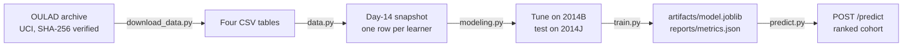

# Learner Early Warning

[](https://github.com/sheygs/learner-early-warning/actions/workflows/ci.yml)

**Machine Learning Zoomcamp midterm · Inspired by Agentic Labs Academy**

A mentor can only check in with a handful of learners each week. This project ranks a course intake at the end of its first two weeks so a mentor can decide who to contact first. The model estimates each learner's risk of withdrawing in the next 30 days from their daily course activity, and a small HTTP service returns the intake in risk order.

The prototype is trained on public Open University data from a historical university course. Treat the scores as a ranking, not as calibrated probabilities. Using them for Academy outreach would require validation on Academy cohorts and a separate evaluation of whether check-ins improve retention.

## Contents

- [Results](#results)
- [How it works](#how-it-works)
- [Tech stack](#tech-stack)
- [Repository layout](#repository-layout)
- [Getting started](#getting-started)
- [API reference](#api-reference)
- [Deployment](#deployment)
- [Development](#development)
- [Design decisions](#design-decisions)
- [Limitations](#limitations)
- [Troubleshooting](#troubleshooting)
- [Rubric evidence](#rubric-evidence)
- [Data attribution](#data-attribution)

## Results

On the held-out **2014J** intake, **30 of 1,726** eligible learners withdrew within the scoring horizon. Logistic regression was selected on the previous intake, 2014B, and refitted before measuring test performance.

| Method                                 | Average precision |    ROC AUC | Expected withdrawals among 10 check-ins |
| -------------------------------------- | ----------------: | ---------: | --------------------------------------: |
| Random shortlist                       |                 — |          — |                                    0.17 |
| No activity in week two                |            0.0244 |     0.6098 |                                    0.32 |
| Days since last activity               |            0.0372 |     0.6808 |                                    0.55 |
| **Logistic regression (served model)** |        **0.0426** | **0.7105** |                                **0.55** |
| Random forest                          |            0.0449 |     0.7567 |                                    0.55 |
| Histogram gradient boosting            |            0.0382 |     0.6646 |                                    0.50 |

How to read the table:

- **Average precision** evaluates the entire ranking, which matters because withdrawals are rare (1.7% of the test intake).
- **Expected withdrawals among 10 check-ins** is what a mentor with ten slots would find. When a score tie straddles tenth place, the count is averaged over the tied learners, so it can be fractional.
- At ten check-ins, logistic regression matched the simple recency rule, and every method returned fewer than one expected withdrawal.
- Random forest had the highest test average precision. The served model stays the validation winner so that the test intake plays no part in model selection ([ADR-0004](docs/adr/0004-chronological-split-and-validation-winner.md)).

The full intake counts, parameters and metrics are in [metrics.json](reports/metrics.json). Figures and feature importance are in [notebook.ipynb](notebook.ipynb).

## How it works



### Prediction timeline

| Course days | What happens                                                                      |
| ----------- | --------------------------------------------------------------------------------- |
| 0–13        | Observation window. The click log is aggregated into 14 daily counts per learner. |
| 14          | Scoring point. Learners registered by day 13 and still enrolled are ranked.       |
| 14–43       | Outcome window. A recorded withdrawal in this period is the positive class.       |

### Data and evaluation choices

| Choice      | Implementation                                                                                                                                                                         |
| ----------- | -------------------------------------------------------------------------------------------------------------------------------------------------------------------------------------- |
| Population  | Learners in course BBB, registered by day 13 and still enrolled when day 14 starts. One record per learner, using their earliest eligible enrolment.                                   |
| Observation | Days 0–13 relative to the course start. Aggregate the click log into 14 daily counts.                                                                                                  |
| Features    | Active days and total clicks in each of the first two weeks, plus days since last observed activity. Days without a recorded click count as zero.                                      |
| Target      | Withdrawal on days 14–43, inclusive. Records marked as withdrawn with an unknown withdrawal date are excluded so unknown outcomes stay out of the negative class.                      |
| Split       | Train on 2013B and 2013J. Tune and select on 2014B. Refit using those three intakes and evaluate on 2014J.                                                                             |
| Selection   | Compare 18 configurations across logistic regression, random forest and histogram gradient boosting. Select by validation average precision and break exact ties with the Brier score. |

The predictors exclude identity, final results, grades and demographic attributes. Learner IDs are used only to join records and remove repeat enrolments, and final results only to exclude withdrawals with missing dates. The same function, `engagement_features` in [data.py](data.py), builds features for training and for API requests.

## Tech stack

| Area          | Choice                                                         |
| ------------- | -------------------------------------------------------------- |
| Language      | Python 3.12                                                    |
| Modelling     | scikit-learn 1.8, pandas 2.2, NumPy 2.3                        |
| Serving       | FastAPI, Pydantic 2, Uvicorn                                   |
| Environment   | [uv](https://docs.astral.sh/uv/) with a committed `uv.lock`    |
| Packaging     | Docker (`python:3.12-slim`), Kubernetes Deployment and Service |
| Quality gates | Ruff, `unittest`, pre-commit, GitHub Actions                   |

## Repository layout

```text
.
├── download_data.py        # Download, verify and extract the OULAD tables
├── data.py                 # Eligibility, labels and the shared feature transformation
├── modeling.py             # Chronological split, tuning, baselines and ranking metrics
├── train.py                # Reproduce the model artifact and the metrics report
├── predict.py              # FastAPI service: /health and /predict
├── notebook.ipynb          # Executed EDA, tuning, evaluation and feature importance
├── artifacts/model.joblib  # Trained model and its metadata (committed)
├── examples/cohort.json    # Sample /predict request
├── reports/                # Metrics, sample response and deployment evidence
├── scripts/smoke_test.py   # Standard-library check of the API contract
├── tests/test_pipeline.py  # Time cutoff, cohort split and tie-handling tests
├── deploy/kubernetes.yaml  # Deployment and ClusterIP Service
├── docs/adr/               # Architecture decision records
├── Dockerfile
├── pyproject.toml
└── uv.lock
```

## Getting started

### Prerequisites

- macOS or Linux
- [uv](https://docs.astral.sh/uv/getting-started/installation/), which installs Python 3.12 and the locked dependencies into `.venv`
- Docker, only for the container and Kubernetes steps
- [kind](https://kind.sigs.k8s.io/docs/user/quick-start/) and `kubectl`, only for the Kubernetes step

### 1. Clone and install

```bash
git clone https://github.com/sheygs/learner-early-warning.git
cd learner-early-warning
uv sync
```

### 2. Download the data

```bash
uv run python download_data.py
```

The archive is about 45 MB. The script verifies its SHA-256 hash and extracts the four required CSV files (about 450 MB) into `data/oulad/`. It skips the download when those files are already present. If you already have the original UCI ZIP, pass it in:

```bash
uv run python download_data.py --archive /path/to/oulad.zip
```

### 3. Train

```bash
uv run python train.py
```

Training tunes the candidates, evaluates on the held-out intake, and writes `reports/metrics.json` followed by `artifacts/model.joblib`.

| Option       | Default                  | Purpose                                 |
| ------------ | ------------------------ | --------------------------------------- |
| `--data-dir` | `data/oulad`             | Directory holding the extracted CSVs    |
| `--archive`  | —                        | Path to a previously downloaded UCI ZIP |
| `--artifact` | `artifacts/model.joblib` | Where to write the model                |
| `--report`   | `reports/metrics.json`   | Where to write the metrics report       |

A trained model is committed, so you can skip steps 2 and 3 and go straight to serving.

### 4. Serve locally

```bash
uv run python -m uvicorn predict:app --host 127.0.0.1 --port 8000
```

Open the interactive [API docs](http://localhost:8000/docs), or send the sample request from a second terminal:

```bash
curl -fsS http://localhost:8000/health
curl -fsS http://localhost:8000/predict \
  -H 'Content-Type: application/json' \
  --data-binary @examples/cohort.json
```

## API reference

### `GET /health`

Returns the loaded model's identity. Used by the Docker health check and the Kubernetes probes.

```json
{
  "status": "ok",
  "model_name": "Logistic regression",
  "model_version": "day14-v1"
}
```

### `POST /predict`

Scores one cohort and returns every learner in descending risk order, so a mentor can take the first ten.

Request:

```json
{
  "learners": [
    {
      "learner_id": "learner-c",
      "daily_clicks": [12, 6, 1, 6, 0, 0, 0, 0, 0, 0, 0, 0, 0, 0]
    },
    {
      "learner_id": "learner-d",
      "daily_clicks": [0, 0, 0, 0, 0, 0, 0, 0, 0, 0, 0, 0, 0, 0]
    }
  ]
}
```

| Field          | Rules                                                                                                              |
| -------------- | ------------------------------------------------------------------------------------------------------------------ |
| `learners`     | 1 to 5,000 entries. Send only learners who are still enrolled at day 14.                                           |
| `learner_id`   | Opaque ID, 1–64 characters: letters, digits, `_`, `.` or `-`, starting with a letter or digit. Unique per request. |
| `daily_clicks` | Exactly 14 integers from 0 to 1,000,000, in course-day order (day 0 first). Use 0 for days without clicks.         |

Unknown fields are rejected. Any violation returns HTTP 422 with the standard FastAPI validation body.

Response:

```json
{
  "model_name": "Logistic regression",
  "model_version": "day14-v1",
  "horizon_days": 30,
  "ranked_learners": [
    { "learner_id": "learner-d", "rank": 1, "risk_score": 0.10999027294580442 },
    { "learner_id": "learner-c", "rank": 2, "risk_score": 0.056586486367734085 }
  ]
}
```

Learners with identical scores are ordered by `learner_id`, so the same request always returns the same ranking. A complete example is in [api-demo.json](reports/api-demo.json).

### Configuration

| Variable     | Default                  | Purpose                                   |
| ------------ | ------------------------ | ----------------------------------------- |
| `MODEL_PATH` | `artifacts/model.joblib` | Model artifact loaded when the app starts |

The service refuses to start if the artifact was trained with a different scikit-learn version, feature list, observation window or prediction horizon. Model artifacts are pickles: load only one from this repository or one you trained yourself.

## Deployment

### Docker

The committed model lets you run the service with Docker alone.

```bash
docker build -t learner-early-warning:1.0 .
docker run --rm --name learner-early-warning -p 127.0.0.1:8000:8000 learner-early-warning:1.0
```

Verify it from a second terminal:

```bash
python3 scripts/smoke_test.py
```

The smoke test uses only the Python standard library. It checks `/health`, the ranking contract and three invalid requests. Pass `--url` to target another address and `--save` to write the response to a file.

The image contains only `data.py`, `predict.py`, the model and the locked runtime dependencies, and runs as a non-root user. [Verified Docker run](reports/docker-deployment.png)

### Kubernetes

The manifest runs on a local cluster. Build the image as above, then:

```bash
kind create cluster --name learner-early-warning
kind load docker-image learner-early-warning:1.0 --name learner-early-warning
kubectl --context kind-learner-early-warning apply -f deploy/kubernetes.yaml
kubectl --context kind-learner-early-warning rollout status deployment/learner-early-warning --timeout=180s
kubectl --context kind-learner-early-warning port-forward service/learner-early-warning 8001:80
```

While the port-forward runs, open the [service docs](http://localhost:8001/docs) or run the smoke test in another terminal:

```bash
python3 scripts/smoke_test.py --url http://localhost:8001
```

[deploy/kubernetes.yaml](deploy/kubernetes.yaml) defines one replica behind a private ClusterIP Service, with readiness and liveness probes on `/health`, CPU and memory limits, a read-only root filesystem, no service-account token and all Linux capabilities dropped.

Remove the cluster when you are done:

```bash
kind delete cluster --name learner-early-warning
```

The manifest was also applied on a local K3s cluster: [video of the rollout and HTTP test](reports/kubernetes-test.mp4) · [deployment transcript](reports/deployment-transcript.txt) · [rollout summary](reports/kubernetes-deployment.png).

## Development

### Commands

| Command                                          | Purpose                                         |
| ------------------------------------------------ | ----------------------------------------------- |
| `uv sync`                                        | Install runtime and dev dependencies            |
| `uv run python -m unittest discover -s tests -v` | Run the unit tests                              |
| `uv run ruff check --fix .`                      | Lint and apply safe fixes                       |
| `uv run ruff format .`                           | Format the code                                 |
| `uv run pre-commit install`                      | Optional: lint, format and lock-check on commit |
| `uv sync --group notebook`                       | Add the notebook dependencies                   |
| `uv run jupyter lab notebook.ipynb`              | Open the notebook, then use **Run All Cells**   |

### Tests

[tests/test_pipeline.py](tests/test_pipeline.py) guards the three properties the evaluation depends on:

- the outcome window is exactly days 14–43 and no click after day 13 reaches the features;
- a learner who retakes the course appears in only one intake;
- expected hits at k does not depend on the order of tied learners.

The tests build small synthetic tables and do not need the OULAD download.

### Continuous integration

[GitHub Actions](.github/workflows/ci.yml) runs on every pull request and every push to `main`:

| Job    | Checks                                                                    |
| ------ | ------------------------------------------------------------------------- |
| Lint   | Lockfile is current, `ruff check`, `ruff format --check`                  |
| Tests  | Unit tests against the locked environment                                 |
| Docker | Builds the image, starts the container and runs the smoke test against it |

## Design decisions

The significant decisions are recorded as [architecture decision records](docs/adr/README.md).

| ADR                                                                | Decision                                                                        |
| ------------------------------------------------------------------ | ------------------------------------------------------------------------------- |
| [0001](docs/adr/0001-rank-for-fixed-outreach-capacity.md)          | Rank a cohort for a fixed outreach capacity instead of classifying each learner |
| [0002](docs/adr/0002-day-14-snapshot-and-label-rules.md)           | Score at day 14 for a 30-day horizon, with explicit eligibility and label rules |
| [0003](docs/adr/0003-activity-only-features-shared-transform.md)   | Use activity-only features built by one transformation shared with the API      |
| [0004](docs/adr/0004-chronological-split-and-validation-winner.md) | Split chronologically by intake and serve the validation winner                 |
| [0005](docs/adr/0005-stateless-batch-ranking-api.md)               | Expose a stateless batch-ranking API with strict input validation               |
| [0006](docs/adr/0006-model-artifact-with-metadata-checks.md)       | Ship the model as a committed, metadata-checked joblib artifact                 |
| [0007](docs/adr/0007-locked-environment-and-hardened-container.md) | Lock the environment and run a hardened, single-replica container               |

## Limitations

- **One course, few positives.** Results come from a single UK distance-learning module, with 30 withdrawals in the test intake. Differences between methods at ten check-ins are within noise.
- **Clicks are a proxy.** The first two weeks of course clicks miss offline study and may reflect logging gaps.
- **Ranking, not probability.** Scores order learners within a cohort. They have not been calibrated or validated as probabilities.
- **No evidence of impact.** The project predicts withdrawal. It does not show that a check-in prevents one.
- **Demo-grade service.** The API has no authentication, rate limiting or monitoring, and the Service is cluster-internal only.

## Troubleshooting

| Symptom                                                                                                                   | Cause and fix                                                                                                                       |
| ------------------------------------------------------------------------------------------------------------------------- | ----------------------------------------------------------------------------------------------------------------------------------- |
| `OULAD archive checksum mismatch. Use the original UCI ZIP.`                                                              | The archive differs from the pinned one. Delete it and rerun `download_data.py`, or pass the original UCI ZIP with `--archive`.     |
| Startup fails with `Install the pinned dependencies or retrain the model with the installed scikit-learn.`                | The installed scikit-learn differs from the one that trained the artifact. Run `uv sync`, or retrain with `uv run python train.py`. |
| Startup fails with `The model artifact uses a different engagement feature schema.` or `…a different prediction horizon.` | `MODEL_PATH` points to an artifact built with other feature or window settings. Retrain it with the current code.                   |
| `/predict` returns HTTP 422                                                                                               | The request breaks a rule in the [API reference](#post-predict). The response body names the field.                                 |
| Pod stuck in `ErrImageNeverPull`                                                                                          | The image is not in the cluster. Rerun `kind load docker-image learner-early-warning:1.0 --name learner-early-warning`.             |

## Rubric evidence

| Midterm criterion                     | Where to review                                                                                                                                                                        |
| ------------------------------------- | -------------------------------------------------------------------------------------------------------------------------------------------------------------------------------------- |
| Problem description                   | Mentor workflow, scoring window and target in this README.                                                                                                                             |
| Exploratory data analysis             | [Notebook](notebook.ipynb) sections 1, 2 and 5 show input checks, cohort prevalence, activity distributions and permutation importance.                                                |
| Model training and tuning             | Notebook sections 3 and 4 compare three model families, parameter grids, two decision rules and an untouched test intake.                                                              |
| Export training to a script           | [train.py](train.py) reproduces the model artifact and evaluation using the same code as the notebook.                                                                                 |
| Reproducibility and environment       | Public dataset with download script, pinned Python dependencies and virtual-environment instructions.                                                                                  |
| Model deployment and containerisation | [predict.py](predict.py), [Dockerfile](Dockerfile) and the HTTP smoke test above.                                                                                                      |
| Cloud or Kubernetes bonus             | [Deployment and Service manifest](deploy/kubernetes.yaml) with local cluster instructions and [a video of the successful rollout and prediction request](reports/kubernetes-test.mp4). |

[Official project rubric](https://github.com/DataTalksClub/machine-learning-zoomcamp/tree/main/projects)

## Data attribution

This project uses the [Open University Learning Analytics Dataset](https://archive.ics.uci.edu/dataset/349/open%2Buniversity%2Blearning%2Banalytics%2Bdataset) (OULAD), created by Jakub Kuzilek, Martin Hlosta and Zdenek Zdrahal and distributed under CC BY 4.0. [Dataset DOI](https://doi.org/10.24432/C5KK69) · [Data descriptor](https://doi.org/10.1038/sdata.2017.171)
